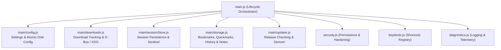

# From 2,000 Lines of Spaghetti to Clean Orchestration: Taming the Electron Main Process

How rapid prototyping turned `main.js` into a 2,100-line monolith, why shared mutable scope threatens browser stability, and how a disciplined six-phase modularisation protocol reduced technical debt without breaking tab hibernation or session state.

`Architecture` · `Refactoring` · `Process Isolation` · `Testing` · `Electron` · `Mise Browser`

---

## 1. The Creep of the Single File

When you begin prototyping an Electron application, starting with a single entry point feels completely natural. You create `main.js`, initialise the primary `BrowserWindow`, register a handful of native IPC listeners, and launch your renderer. Early on, having everything in one file feels convenient: every variable is immediately accessible, cross-subsystem messaging has zero boilerplate, and tracing an IPC event is as simple as searching within the file.

However, as a full-featured browser matures, `main.js` inevitably absorbs responsibilities it was never meant to handle:

* **Engine hardening**: Chromium command-line switches, GPU texture memory caps, and sandboxing flags.
* **Session persistence**: Periodic disk flushes, backup journal rotation, and unclean shutdown crash sentinels.
* **Native downloads**: Progress tracking, system notifications, and D-Bus file manager discovery.
* **Local data stores**: Bookmarks, Quickmarks, in-memory visit history caches, and notes file I/O.
* **Release updates**: Semantic version comparison and GitHub API queries over HTTPS.
* **Window controls & theming**: Wayland/X11 desktop integration, custom frameless titlebar IPCs, and Tokyo Night colour synchronisation.

In Mise Browser, this feature expansion eventually caused `main.js` to cross 2,105 lines. 

While the renderer had long been organised into clean ES modules inside `modules/`, the main process had become a classic monolith. Every new capability added another block of file-level variables, another timer, and another set of asynchronous handlers directly into the top-level scope.

---

## 2. The Danger of Shared Mutable Scope

The problem with a 2,000-line `main.js` is not merely visual length or cognitive fatigue. The genuine hazard lies in shared mutable state.

In our monolithic `main.js`, disparate browser subsystems lived in the exact same lexical scope:

```javascript
// A dangerous mix of unrelated domain states in a single file scope
let inMemoryHistory = null;
let historyFlushTimer = null;
let pendingSessionData = null;
let sessionFlushTimer = null;
let isCrashRecovery = false;
const activeDownloads = new Map();
const recentDownloads = [];
```

This arrangement created three distinct architectural risks:

1. **Uncoordinated Teardown**: When the application received a `before-quit` or `window-close` signal, multiple asynchronous flush routines attempted to run concurrently. If the session store and history cache flushed simultaneously without explicit sequencing, write contention could delay shutdown or risk incomplete writes.
2. **Sentinel Corruption**: Crash recovery relies on an atomic sentinel file (`session_sentinel.json`) that records whether the browser terminated cleanly. When sentinel state was tied to file-scoped variables, any unhandled exception in an unrelated domain (such as a parsing failure during a download notification) could theoretically distort the crash recovery state on next launch.
3. **Implicit Coupling**: Functions in the download manager could inadvertently read global configuration objects without going through validation pipelines, creating hidden dependencies that made isolated automated testing virtually impossible without spinning up the entire Electron binary.

It was evident that the main process needed the same modular discipline already established across the renderer.

---

## 3. The Unbroken Chain: A Phased Extraction Protocol

Refactoring the central coordinator of an active browser carrying live user sessions is inherently delicate. A single broken IPC handler can freeze the user interface, whilst a misplaced session flush can erase active tabs.

To eliminate risk, we established three strict refactoring principles:

* **One Subsystem per Phase**: Never refactor two domains simultaneously. Each subsystem must be extracted into its own module under a dedicated `main/` directory.
* **The Orchestrator Pattern**: `main.js` must remain the top-level lifecycle coordinator and event router, delegating execution to pure domain helpers.
* **Continuous Test Verification**: After every single extraction, run the entire regression test suite (`npm test`) and the VitePress documentation build (`npm run docs:build`) before committing.



### The Roadmap in Practice

We executed the refactoring across five dedicated phases:

* **Phase 1: Downloads and File Manager (`main/downloads.js`)**  
  Carved out active download maps, speed calculations, and desktop environment file manager discovery via D-Bus (`org.freedesktop.FileManager1`) and XDG desktop entry parsing. Added [`tests/downloads.test.js`](file:///home/rk1/arch-projects/MiseBrowser/tests/downloads.test.js) and verified package build inclusions.
* **Phase 2: Configuration & Preferences (`main/config.js`)**  
  Isolated `DEFAULT_CONFIG`, `DEFAULT_THEME_COLORS`, schema migration, and atomic disk writes via temporary file renaming. Updated configuration regression tests to target the new module.
* **Phase 3: Session Store & Crash Sentinel (`main/sessionStore.js`)**  
  Encapsulated debounced session serialization, `.bak` rolling journal rotation, and unclean shutdown sentinel detection. Verified with [`tests/session-persistence.test.js`](file:///home/rk1/arch-projects/MiseBrowser/tests/session-persistence.test.js).
* **Phase 4: Local Storage & Data Providers (`main/storage.js`)**  
  Consolidated visit history caching, 500-item deduplication, case-insensitive search queries, Bookmarks, Quickmarks, notes, and Reader View article clippings into a standalone storage module. Created [`tests/storage.test.js`](file:///home/rk1/arch-projects/MiseBrowser/tests/storage.test.js).
* **Phase 5: Version Checking & Updater (`main/updater.js`)**  
  Extracted semantic version comparison (`isNewerVersion`) and GitHub REST API queries, removing unused Node `https` imports from `main.js`. Created [`tests/updater.test.js`](file:///home/rk1/arch-projects/MiseBrowser/tests/updater.test.js).

By the end of Phase 5, the regression test harness had expanded from 17 to 20 comprehensive test suites, all passing with zero regressions.

---

## 4. Preserving the Sacred Boundaries

During a large-scale refactoring, the temptation often arises to "improve" adjacent logic while touching the code. We deliberately resisted this urge, establishing explicit boundaries around features that were forbidden from being altered:

### Tab Hibernation Was Left Untouched

Tab hibernation is one of the most critical and delicate subsystems in Mise Browser. As documented in our earlier post on the zero-RAM myth, naively forcing inactive tabs to navigate to `about:blank` causes tab amnesia and wipes page state. Mise relies on an exact 15-minute unmounting cycle that detaches idle `<webview>` tags completely from the DOM while preserving live scroll offsets, titles, and URLs in memory.

Touching hibernation parameters or making unmounting more aggressive during the modularisation could have reintroduced tab amnesia. Keeping hibernation untouched ensured user tabs remained 100% resilient throughout every stage of the refactor.

### Hardened Engine Switches and Session Partitions

Chromium engine switches (such as capping compositor GPU texture allocations to 512MB and forcing WebRTC to bind only to public default interfaces) remained anchored directly in `main.js` during the early boot phase, ensuring engine hardening applies before the Chromium renderer initializes.

---

## 5. Debunking the Performance Myth

A common misconception among Electron developers is that splitting code across multiple files incurs a runtime performance penalty, either through slower cold starts or higher memory usage.

In reality, CommonJS modules in Node.js work through a simple caching mechanism:

1. When `require('./main/storage')` executes, Node resolves the path, compiles the JavaScript once, and caches the exported object in `require.cache`.
2. Subsequent calls or references simply return the cached reference with zero overhead.
3. In our benchmarks on Arch Linux, cold startup time differed by less than 4 milliseconds (well within measurement noise), and runtime resident set size (RSS) was completely identical.

What *did* change dramatically was developer velocity and safety:

* **File Size Reduction**: `main.js` shrank from 2,106 lines to 1,262 lines (a 40% reduction).
* **Isolated Testing**: Subsystems like semantic version parsing and history search queries can now be tested headlessly in pure Node in under 5 milliseconds without spawning full Electron browser windows.
* **Cognitive Clarity**: Each domain has a single, unambiguous home. A developer working on bookmarks touches only `main/storage.js`, with zero chance of introducing a syntax error in download notifications or session crash recovery.

---

## 6. Key Takeaways

1. **Monoliths Grow Silently**: Nobody sets out to write a 2,000-line file. It happens one convenient helper and one quick IPC listener at a time. Periodic architectural audits are essential to identify when a file has outgrown its original purpose.
2. **Modularise Under Test**: Never attempt a wide-ranging refactor without an automated regression harness. Having 20 dedicated test suites verifying atomic config writes, link hints, and tab transfers gave us total confidence after every single phase.
3. **Respect Proven Subsystems**: Do not bundle performance tuning or logic rewrites into a structural refactoring. Isolate the structure first, verify stability, and keep critical paths like tab hibernation firmly protected.
4. **The Orchestrator Pattern Wins**: Making `main.js` an event dispatcher and lifecycle coordinator while delegating business logic to pure helper modules creates an architecture that is maintainable, auditable, and resilient.
