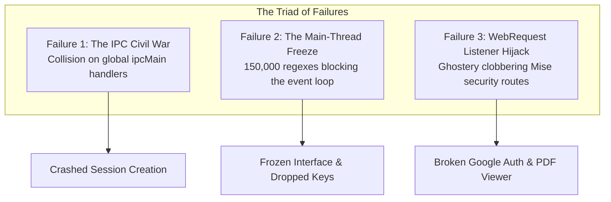
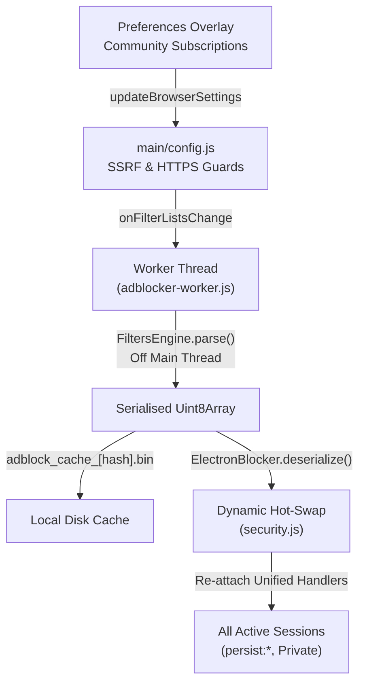

# The Ghostery IPC Civil War: Adblocking Across Isolated Partitions

How strict multi-account container partitions caused IPC collisions in the adblocking engine, why compiling 150,000 rules froze the user interface, and how off-thread compilation and dynamic hot-swapping restored harmony.

`Content Blocking` · `Chromium Partitions` · `IPC Architecture` · `Worker Threads` · `Electron` · `Mise Browser`

---

## 1. The Problem: Clean Partitions vs Content Blocking

Mise Browser is built around containerised isolation. Instead of sharing a monolithic profile where advertising beacons and analytics scripts can correlate user identity across unrelated web activities, Mise partitions browsing into distinct Chromium sessions:

* Standard workspaces live in discrete persistent stores (`persist:workspace_<id>`).
* Private browsing runs inside an ephemeral, in-memory partition (`MisePrivateProfile`).

This multi-container architecture is central to Mise's privacy model. However, privacy also demands robust network request filtering. Unwanted trackers, telemetry beacons, and intrusive advertisements must be neutralised before network requests leave the machine.

To achieve native adblocking without the memory overhead and Manifest V3 limitations of third-party browser extensions, Mise integrates `@ghostery/adblocker-electron`. Ghostery's engine parses standard community filter lists (such as EasyList, EasyPrivacy, and uBlock filters), matches outbound URLs against tens of thousands of rules, and injects cosmetic CSS rules to hide ad elements.

In a conventional single-profile browser, integrating Ghostery is straightforward. But when you introduce multiple concurrent container sessions, dynamic workspace creation, and community filter list subscriptions, the integration quickly turns into an architectural battleground.

---

## 2. The Solution (My First Attempt)

My initial implementation followed standard library examples. Whenever a tab opened in a workspace, the application ensured the session was configured with network blocking:

```javascript
// Naive per-session blocker attachment
async function configureSessionBlocking(targetSession) {
    const blocker = await ElectronBlocker.fromPrebuiltAdsAndTracking(fetch);
    blocker.enableBlockingInSession(targetSession);
}
```

On a single workspace with one or two tabs, this appeared to function as expected: ads were blocked, tracker domains were dropped, and resource consumption remained low.

Encouraged by this initial success, I moved to the next logical step: allowing users to subscribe to additional community filter lists (EasyList, EasyPrivacy, uBlock Annoyances, Fanboy Social, and custom HTTPS blocklists) in the Preferences overlay, recompiling the rule engine whenever settings changed.

That was when the architecture unravelled.

---

## 3. The Bugs / The Fails

Running a multi-container browser with configurable community subscriptions exposed three severe architectural failures:



### A. The IPC Civil War: Collision Across Partitions

The first failure struck as soon as a user opened a second workspace or launched the Private Profile. The application threw an unhandled exception:

```text
Error: Attempted to register a second handler for '@ghostery/adblocker/inject-cosmetic-filters'
    at IpcMainImpl.handle (node:electron/js2c/browser_init:165:13)
    at BlockingContext.enable (node_modules/@ghostery/adblocker-electron:...)
```

Why did this occur?

Ghostery injects cosmetic filters (CSS selectors that hide promotional banners in the DOM) by registering custom IPC handlers via `ipcMain.handle`. When `blocker.enableBlockingInSession(sessionA)` was called, it registered:

* `@ghostery/adblocker/inject-cosmetic-filters`
* `@ghostery/adblocker/is-mutation-observer-enabled`
* `@ghostery/adblocker/cosmetic-filters`

In Electron, `ipcMain` is a process-wide singleton. You cannot register multiple handlers for the same IPC channel. When `sessionB` (our second workspace partition) attempted to enable blocking, Ghostery tried to register the exact same IPC channels again, causing Electron to throw an immediate error and crash the tab lifecycle.

### B. The Main-Thread Freeze: 150,000 Rules on the Event Loop

The second failure appeared during filter list compilation.

Standard community filter lists are massive. Between EasyList, EasyPrivacy, uBlock Annoyances, and Fanboy Social, an adblocking engine must ingest over 150,000 distinct rule lines. Each line must be tokenised, converted into regular expressions, indexed into reverse hostname trees, and formatted into cosmetic stylesheet rules.

When this compilation executed on Electron's main process thread, the JavaScript event loop came to a complete halt for 400 to 1,200 milliseconds. Because Mise is a keyboard-centric browser with real-time Vim normal-mode shortcuts, address bar autocompletion, and live status bar updates, this hitching was intolerable. Keystrokes were dropped, UI animations stuttered, and the browser felt sluggish.

### C. The WebRequest Listener Hijack

Electron imposes a strict runtime constraint: **only one listener can be registered per `webRequest` event**.

When `blocker.enableBlockingInSession(session)` was invoked, Ghostery internally attached its own callbacks to `session.webRequest.onBeforeRequest` and `session.webRequest.onHeadersReceived`. In doing so, it completely displaced Mise's native security interceptors:

* The Google sign-in WebLite authentication rewriter (`flowName=WebLiteSignIn`) was discarded, triggering Google Botguard blocks.
* The local PDF viewer interception that routes `.pdf` documents to the vendored PDF.js viewer was bypassed, causing Chromium to download raw binary files instead of displaying them inline.

Conversely, if Mise re-attached its own network listeners afterward, Ghostery's listeners were overwritten, silently disabling adblocking altogether.

---

## 4. The Architectural Fix

To solve these collisions permanently, I redesigned the adblocking subsystem from the ground up around four core architectural principles:



### 1. Off-Thread Worker Compilation (`adblocker-worker.js`)

Heavy CPU-bound rule parsing was completely removed from the main process and delegated to a dedicated Node.js worker thread (`node:worker_threads`).

The main process fetches the list texts asynchronously, passes the strings into `adblocker-worker.js`, and lets the worker build and serialise the engine:

```javascript
// adblocker-worker.js
const { parentPort, workerData } = require('node:worker_threads');
const { FiltersEngine } = require(workerData.engineModulePath);

// One-shot worker parsing adblock rule lists off the main event loop
try {
    const engine = FiltersEngine.parse(workerData.lists.join('\n'));
    if (workerData.resources !== undefined) {
        engine.updateResources(workerData.resources, String(workerData.resources.length));
    }
    const bytes = engine.serialize();
    parentPort.postMessage(bytes, [bytes.buffer]);
} finally {
    parentPort.close();
}
```

The resulting `Uint8Array` binary buffer is transferred back to the main process via zero-copy buffer transfer. The UI thread never drops a single frame.

### 2. Deterministic SHA-256 Recipe Caching

Compiling 150,000 rules in a worker is fast, but avoiding compilation altogether is even faster.

I implemented deterministic cache keys based on the sorted list of active subscription URLs:

```javascript
function getFilterCachePath(recipeUrls) {
    if (!recipeUrls || recipeUrls === adsAndTrackingLists) {
        return path.join(userDataDir, 'adblock_cache.bin');
    }
    const sorted = Array.from(recipeUrls).sort().join('\n');
    const hash = crypto.createHash('sha256').update(sorted).digest('hex').slice(0, 16);
    return path.join(userDataDir, `adblock_cache_${hash}.bin`);
}
```

If a user toggles uBlock Annoyances off and back on again, Mise never touches the network or the worker thread: it loads the precompiled `adblock_cache_<hash>.bin` directly into memory via `ElectronBlocker.deserialize(buffer)` in under 15 milliseconds.

### 3. Unified WebRequest Multiplexing

To prevent Ghostery and Mise from fighting over Electron's single `webRequest` listener slot, I introduced unified network multiplexers in `security.js`.

Mise's security requirements (Google sign-in rewrites and PDF viewer routing) run first. If the request is not redirected, control hands over cleanly to Ghostery's matcher:

```javascript
function attachNetworkHandlers(targetSession) {
    if (!targetSession.webRequest) return;

    const blockingEnabled = () => blockerInstance && blockerInstance.isBlockingEnabled(targetSession);

    targetSession.webRequest.onBeforeRequest({ urls: ['<all_urls>'] }, (details, callback) => {
        // 1. Google WebLite auth flow routing
        const url = details.url || '';
        if (url.includes('flowName=GlifWebSignIn') && /^https?:\/\/accounts\.google\.com\//i.test(url)) {
            return callback({ redirectURL: url.replaceAll('flowName=GlifWebSignIn', 'flowName=WebLiteSignIn') });
        }
        // 2. Hand off to Ghostery request engine
        if (blockingEnabled()) return blockerInstance.onBeforeRequest(details, callback);
        callback({});
    });

    targetSession.webRequest.onHeadersReceived({ urls: ['<all_urls>'] }, (details, callback) => {
        // 1. Intercept main-frame PDF navigations
        if ((details.resourceType === 'main_frame' || details.resourceType === 'mainFrame') && details.url) {
            if (isPdfResponse(details)) {
                return callback({ redirectURL: mintPdfViewerUrl(details.url) });
            }
        }
        // 2. Hand off to Ghostery response engine
        if (blockingEnabled()) return blockerInstance.onHeadersReceived(details, callback);
        callback({ responseHeaders: details.responseHeaders });
    });
}
```

### 4. Dynamic Live Hot-Swapping Across Sessions

When the user updates filter subscriptions in Preferences, Mise must apply the new rules immediately across all open tabs in all workspaces without requiring an application restart.

The `reloadAdblocker` function coordinates this atomic swap:

1. Compiles the new engine off-thread (or loads it from disk cache).
2. Applies exception diffs (YouTube and Twitter scriptlet exceptions).
3. Re-applies the user's custom **Trusted Sites** exceptions via `updateFromDiff`.
4. Prunes stale Ghostery IPC handlers from `ipcMain`.
5. Replaces `blockerInstance` with the newly compiled engine.
6. Iterates through all active container sessions, enabling blocking and re-attaching the unified multiplexer.

Every open tab in every workspace immediately inherits the new filter set on its very next network request.

### 5. SSRF and Protocol Lockdown

Allowing users to add custom subscription URLs introduces potential security vulnerabilities. A malicious or compromised subscription URL could point to internal network services or loopback addresses.

In `main/config.js`, custom URLs pass through strict security validation before being accepted:

* **Strict HTTPS Only**: Insecure `http://`, `file://`, and `data:` schemes are rejected unconditionally.
* **SSRF Guard**: Localhost (`127.0.0.1`, `localhost`, `::1`) and private IPv4/IPv6 subnets (`10.0.0.0/8`, `192.168.0.0/16`, `172.16.0.0/12`, `169.254.0.0/16`) are blocked.
* **Bounded Allocations**: Maximum of 10 custom subscription URLs, capped at 2,048 characters per URL, with network fetches guarded by a 15-second abort controller.

---

## 5. Lessons Learned & Key Takeaways

1. **Beware Singleton IPC Handlers in Modular Architectures**: Libraries designed for single-window or single-profile Electron apps often register global IPC handlers naively. When building containerised browsers, wrap third-party registrations with explicit lifecycle guards and cleanup handlers.
2. **Never Monopolise Exclusive Platform APIs**: When a platform runtime offers only a single listener slot (like Electron's `webRequest`), create an explicit, priority-ordered multiplexer. Trying to let two subsystems register listeners independently will always result in silent breakage.
3. **Offload Heavy Parsing Before It Hurts**: Parsing text rules and generating ASTs in the main process is a recipe for frame drops. Worker threads are lightweight, safe, and keep keyboard input buttery smooth.
4. **Security Must Encircle User Extensibility**: Any feature that allows users to supply URLs that the main process will fetch must be treated as a potential SSRF attack vector. Enforce strict HTTPS protocols and private IP filtering at the configuration boundary.

---

### Community & Discussion

Interested in discussing technical architectural decisions, bugs, or upcoming chronicles? Join the conversation on [Reddit (r/mise_browser)](https://www.reddit.com/r/mise_browser/) or connect on [Mastodon (@misebrowser@mastodon.social)](https://mastodon.social/@misebrowser).
