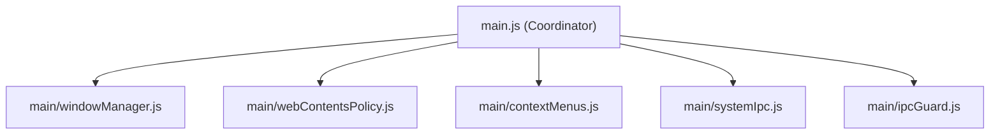

# The Modularisation Minefield: 5 Hidden Traps That Almost Broke the Main Process

Why extracting a monolithic `main.js` into clean subsystems is fraught with runtime hazards: circular dependencies, webview teardown races, IPC friendly fire, and shutdown sentinel corruption.

`Refactoring` · `Process Isolation` · `IPC Architecture` · `Race Conditions` · `Electron` · `Mise Browser`

---

## 1. The Problem: The Illusion of Clean Extraction

Architectural diagrams on a whiteboard always look clean. You take a monolithic, 2,100-line `main.js`, identify the distinct responsibilities, and plan neat submodules under a new `main/` directory:



On paper, this appears to be routine modularisation. You move functions, export signatures, and import dependencies.

However, in an active Electron browser, `main.js` is not a passive utility library. It is a live, stateful coordinator orchestrating Chromium command-line switches, GPU texture memory pools, containerised session partitions, and hardware sensor policies. Dissecting it while keeping tab hibernation, multi-workspace isolation, and crash sentinels fully functional is a journey through a minefield.

During Phase 4 of our modularisation roadmap, we encountered five distinct technical traps that threatened browser stability. Here is the post-mortem of what went wrong, why it failed, and the architectural patterns that resolved each issue.

---

## 2. Trap 1: The Circular Dependency & Early-Boot Deadlock

### The Attempt
When extracting window lifecycle management into [`main/windowManager.js`](file:///home/rk1/arch-projects/MiseBrowser/main/windowManager.js), that module naturally owned the primary `BrowserWindow` instance (`mainWindow`).

However, virtually every other extracted subsystem required access to that window:
* [`main/contextMenus.js`](file:///home/rk1/arch-projects/MiseBrowser/main/contextMenus.js) needed `mainWindow` to position native menus and dispatch link actions.
* [`main/systemIpc.js`](file:///home/rk1/arch-projects/MiseBrowser/main/systemIpc.js) needed it to send system notifications and reader distilled markdown.
* [`main/webContentsPolicy.js`](file:///home/rk1/arch-projects/MiseBrowser/main/webContentsPolicy.js) needed it to coordinate child window navigation.
* [`main/ipcGuard.js`](file:///home/rk1/arch-projects/MiseBrowser/main/ipcGuard.js) needed it to verify whether incoming IPC senders matched the authentic host window.

Initially, each subsystem simply imported `windowManager.js`:

```javascript
// A classic circular dependency hazard
const { getMainWindow } = require('./windowManager');
```

### The Fail
Node.js handles circular CommonJS dependencies by returning an incomplete, partially loaded `exports` object. On cold application startup, when `systemIpc.js` or `ipcGuard.js` ran during early bootstrap, `windowManager.js` was still in the middle of resolving its own imports.

As a result, `getMainWindow` was silently bound as `undefined`. When an incoming single-instance URL arrived from the command line, the application threw an immediate fatal TypeError: `getMainWindow is not a function`, crashing before the browser chrome even rendered.

### The Architectural Fix: Late-Bound Dependency Injection
Instead of relying on circular module imports, we established a strict functional dependency injection pattern. No subsystem is permitted to import `windowManager.js` directly. Instead, subsystems accept a late-bound getter closure during initialisation:

```javascript
// Explicit late-bound dependency injection in main.js
contextMenus.setMainWindowGetter(getMainWindow);

systemIpc.registerSystemIpc(ipcMain, {
    getMainWindow,
    sendNotification: sendSystemNotification,
    areNotificationsEnabled: () => globalNotificationsEnabled
});
```

Because `getMainWindow` is passed as a function reference and invoked only when an event fires, `mainWindow` is evaluated dynamically at invocation time, eliminating circular evaluation deadlocks.

---

## 3. Trap 2: The `<webview>` Teardown Race Condition

### The Attempt
Security in Mise Browser requires that no untrusted web content ever runs with Node integration or unrestricted capabilities. We centralised all security enforcement inside [`main/webContentsPolicy.js`](file:///home/rk1/arch-projects/MiseBrowser/main/webContentsPolicy.js) using Electron's `app.on('web-contents-created')` hook.

Whenever a new guest `<webview>` attached to the DOM, this policy hook configured session security, attached navigation guards, and enforced frame sandboxing.

### The Fail
The problem arose when tabs were closed rapidly or during tab hibernation cycles.

In Mise, idle tabs undergo memory harvesting: their `<webview>` DOM element is detached from the viewport while preserving URL and scroll offsets in memory. When a user closed a tab while it was still initialising, a destructive race condition emerged:

1. Chromium started creating the underlying C++ `WebContents` instance.
2. The user closed the tab, causing [`modules/webview.js`](file:///home/rk1/arch-projects/MiseBrowser/modules/webview.js) to immediately detach the DOM node.
3. Electron's asynchronous event loop delivered the delayed `web-contents-created` callback on the main process thread.
4. When `webContentsPolicy.js` attempted to attach listeners to the guest contents, Chromium had already marked the underlying C++ object as destroyed.

The main process crashed with an unhandled exception:

```text
Error: Object has been destroyed
    at WebContents.setWindowOpenHandler (node:electron/js2c/browser_init:...)
    at attachWebviewSecurityGuards (main/webContentsPolicy.js:42:16)
```

### The Architectural Fix: Defensive Destruction Guards
We audited every lifecycle callback interacting with guest webviews. Before calling any Electron C++ method, the policy layer verifies that the web contents instance is alive:

```javascript
// main/webContentsPolicy.js
function attachWebviewSecurityGuards(wc, hooks = {}) {
    if (!wc || (typeof wc.isDestroyed === 'function' && wc.isDestroyed())) {
        return;
    }

    // Wrap navigation handlers with destruction guards
    wc.on('will-navigate', (event, url) => {
        if (wc.isDestroyed()) return;
        // Evaluate navigation safety...
    });
}
```

This simple, defensive boundary completely immunised the tab manager against rapid closure and hibernation races.

---

## 4. Trap 3: The IPC Guard Friendly-Fire Disaster

### The Attempt
Electron applications that host untrusted web content in `<webview>` tags face severe privilege-escalation risks if guest scripts can invoke host IPC channels (`ipcMain.handle` and `ipcMain.on`).

To protect the host process, we created [`main/ipcGuard.js`](file:///home/rk1/arch-projects/MiseBrowser/main/ipcGuard.js). It wraps every IPC handler registered across the application and inspects the sender:

```javascript
function isFromHost(event, getMainWindow) {
    const win = getMainWindow();
    if (!win || !win.webContents || event.sender !== win.webContents) {
        return false;
    }
    if (event.senderFrame !== undefined && event.senderFrame !== event.sender.mainFrame) {
        return false;
    }
    return true;
}
```

If an event originates from an untrusted guest frame, `ipcGuard` unconditionally throws `Error('Forbidden')`.

### The Fail
The moment we installed `ipcGuard` in enforce mode, legitimate browser features began breaking across the application:

1. **The PDF Viewer**: Mise features a built-in, local PDF viewer. When a user opened a PDF document, the viewer rendered an empty grey screen. The viewer's preload script was trying to fetch the file bytes via `read-pdf-data`, but because the viewer ran inside a guest frame, `ipcGuard` intercepted the call and denied it with `Forbidden`.
2. **Userscript Storage**: User scripts leveraging `GM_setValue` and `GM_getValue` threw storage exceptions on every page load.
3. **Cosmetic Adblock Filters**: Ghostery's adblocker uses guest IPC to inject element-hiding stylesheets into pages. `ipcGuard` blocked the cosmetic injection handlers, leaving blank banner placeholders across web pages.

### The Architectural Fix: Explicit Guest Channels & Dual-Mode Telemetry
The solution was not to weaken our security checks, but to make the guest boundary explicit and auditable:

1. We defined an immutable, frozen allowlist (`GUEST_CHANNELS`) listing only channels explicitly engineered for guest consumption:

```javascript
// main/ipcGuard.js
const GUEST_CHANNELS = Object.freeze([
    'gm-xmlhttprequest',
    'gm-storage-set',
    'gm-storage-delete',
    'gm-storage-get',
    'get-pdf-viewer-path',
    'read-pdf-data',
    'save-pdf-file',
    'is-trusted-domain',
    'get-webrtc-policy',
    'get-google-signin-user-agent',
    '@ghostery/adblocker/inject-cosmetic-filters',
    '@ghostery/adblocker/is-mutation-observer-enabled',
    '@ghostery/adblocker/cosmetic-filters'
]);
```

2. We added a configurable environment mode (`MISE_IPC_GUARD=warn`) for test environments and logging diagnostics, switching to strict `enforce` mode in production builds.

Now, untrusted web frames can never access host filesystem, configuration, or window controls, while legitimate guest capabilities operate seamlessly.

---

## 5. Trap 4: The Shutdown Sentinel Inversion

### The Attempt
Crash recovery in Mise Browser is governed by an atomic sentinel file (`session_sentinel.json`) managed by [`main/sessionStore.js`](file:///home/rk1/arch-projects/MiseBrowser/main/sessionStore.js).

When the browser boots, it checks the sentinel:
* If the sentinel indicates `clean: false`, the previous session crashed or suffered an unclean shutdown (e.g. power loss), prompting Mise to offer recovery options.
* When the browser closes normally, it marks the sentinel `clean: true`.

### The Fail
During the extraction of `sessionStore.js` and [`main/storage.js`](file:///home/rk1/arch-projects/MiseBrowser/main/storage.js), we placed `markSentinelState(true)` in the `before-quit` handler.

However, because session flushing and history caching were asynchronous, a race condition occurred on exit:
1. `markSentinelState(true)` wrote to disk immediately.
2. The operating system began terminating the process while the large history journal and session tabs were still writing their final payloads.
3. On next boot, the sentinel claimed the shutdown had been clean, but the session file was truncated or corrupted, destroying user tab state without triggering crash recovery.

Conversely, if we delayed marking the sentinel until after promises resolved, Electron often exited before the write completed, causing *every single clean reboot* to be falsely diagnosed as a crash.

### The Architectural Fix: Coordinated Synchronous Flush Ordering
Shutdown cannot rely on loose asynchronous promises. In `main.js`, we established strict synchronous shutdown sequencing:

```javascript
// Strict synchronous exit coordination in main.js
app.on('before-quit', () => {
    markSentinelState(true);
    flushSessionToDisk();
    flushHistoryToDisk();
});
```

By ensuring that `flushSessionToDisk()` and `flushHistoryToDisk()` execute synchronously using atomic temporary file renaming (`atomicFile.js`) immediately following sentinel state marking, exit ordering is deterministic. Corrupt session states and phantom crash alerts were eliminated permanently.

---

## 6. Trap 5: The Silent Packaging Drop

### The Attempt
Throughout the modularisation, we maintained 100% test passes across all automated regression suites (`npm test`). Every module had unit coverage, and running `npm start` launched the development browser without errors.

Confident in our changes, we ran the distribution packaging command:

```bash
npm run dist:linux
```

### The Fail
The packaging completed with exit code 0. But when we executed the compiled AppImage binary on a clean Arch Linux installation, the application crashed instantly:

```text
Error: Cannot find module './main/windowManager'
    at Module._resolveFilename (node:internal/modules/cjs/loader:1145:15)
```

Why did this occur when all local tests had passed?

In [`package.json`](file:///home/rk1/arch-projects/MiseBrowser/package.json), `electron-builder` relies on an explicit `files` glob to select which files are bundled into the binary package:

```json
"files": [
  "main.js",
  "preload.js",
  "webview-preload.js",
  "security.js"
]
```

Because `main.js` had previously been a standalone file in the project root, the `files` array had never included a directory path for `main/`. When `electron-builder` packaged the app, it bundled `main.js` but completely dropped the entire `main/` directory containing our new subsystems.

### The Architectural Fix: Production Packaging Verification
We updated `package.json` to include `"main/**/*"`:

```json
"files": [
  "main.js",
  "main/**/*",
  "preload.js",
  "webview-preload.js",
  ...
]
```

More importantly, we authored a dedicated regression test (`tests/main-modularisation.test.js`) that verifies that every single extracted subsystem file exists, contains logic, and is explicitly included in the distribution packaging rules.

---

## 7. Lessons Learned & Key Takeaways

1. **Late-Bound Closures Defeat Circular Deadlocks**: When modularising monolithic codebases, avoid importing coordinators circularly. Pass functional getters (`getMainWindow`) during initialization so resolution occurs at execution time.
2. **Defend Against C++ Object Destruction**: In Electron, Chromium WebContents can be destroyed while Node.js events are still queued in the microtask pipeline. Always guard callbacks with `!wc.isDestroyed()`.
3. **Formalise IPC Security Boundaries Early**: If you introduce a security guard to block untrusted frames, document and freeze an explicit allowlist of legitimate guest channels before flipping the switch to enforce mode.
4. **Exit Ordering Must Be Deterministic**: Shutdown state persistence cannot be left to floating asynchronous promises. Coordinate sentinel updates and disk flushes synchronously.
5. **A Green Test Suite Does Not Guarantee a Working Package**: Automated test suites running in development check local files on disk. Always verify your bundler's packaging definitions (`package.json` files glob) as part of your regression harness.

---

### Community & Discussion

Interested in discussing technical architectural decisions, bugs, or upcoming chronicles? Join the conversation on [Reddit (r/mise_browser)](https://www.reddit.com/r/mise_browser/) or connect on [Mastodon (@misebrowser@mastodon.social)](https://mastodon.social/@misebrowser).
